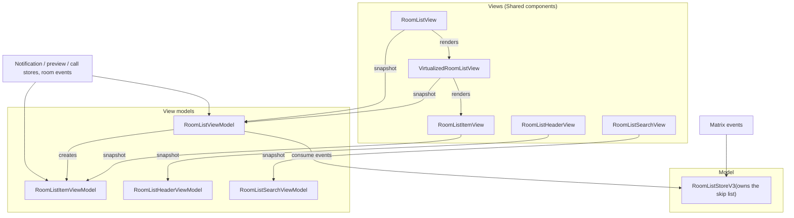

# Room list

The room list is the sorted, filtered list of rooms in the left-hand navigation panel, always
scoped to the active space. It is a full [MVVM](MVVM.md) feature split across three layers:

- **Model** — `RoomListStoreV3`, the store that keeps every room sorted and answers queries for
  the rooms in the active space. It lives in
  [`apps/web/src/stores/room-list-v3/`](https://github.com/element-hq/element-web/tree/develop/apps/web/src/stores/room-list-v3/).
- **View models** — adapt the store (and other stores) into snapshots for the UI. They live in
  [`apps/web/src/viewmodels/room-list/`](https://github.com/element-hq/element-web/tree/develop/apps/web/src/viewmodels/room-list/).
- **Views** — the presentational React components, owned by `@element-hq/web-shared-components`.

## Architecture

## Model — the store

`RoomListStoreV3` (the "V3" is the third implementation) is a singleton exposed as
`RoomListStoreV3.instance`. Unlike the previous implementations, which re-computed lists on
demand, V3 keeps every room permanently sorted so retrieval is cheap.

**The skip list.** The core data structure is a
[skip list](https://en.wikipedia.org/wiki/Skip_list): stacked linked lists that keep every room
permanently sorted, so a room that changes is simply re-inserted into place and the rest of the
list is untouched. Rooms are wrapped in `RoomNode`s that cache whether the room is in the active
space and which filters it matches, so reading the list is just an ordered walk that drops the
nodes outside the space or not matching the requested filters.

**Sorters.** A sorter defines the order of the list. There are three: **Alphabetic** (by room
name), **Recency** (most recent meaningful activity, with low-priority and muted rooms forced to
the bottom), and **Unread** (by unread importance). The user's choice is persisted and can be
changed at runtime, which rebuilds the list.

**Filters.** A filter answers a single yes/no question about a room, and each room's matching
filters are precomputed on its node. The filters back the primary filter chips in the UI (Unread,
People, Rooms, Favourites, Mentions, Invites, Low Priority).

**Spaces and updates.** The list is always scoped to the active space; rather than re-filter on
every read, each node caches its active-space membership and the store recomputes that flag when
the space changes. The store listens for the Matrix events that affect ordering or membership
(receipts, tag changes, account data, push rules, decryption, timeline events, membership) and
responds by re-inserting or removing the single affected room. Emissions to consumers are
coalesced with `requestAnimationFrame`, so a burst of updates within a frame collapses into one
notification.

**Public surface.** This is the seam the view models bind to:

- Events: `ListsUpdate` (lists changed) and `ListsLoaded` (initial load done).
- `getSortedRoomsInActiveSpace(filterKeys?)` returns the sorted, filtered rooms. Narrower helpers
  exist too (DM rooms, server-notice rooms, the full sorted list).
- `resort`.

Note that **sticky-room behaviour lives in the view model, not the store** — the store itself is
unaware of a selected room.

## View models

The view models in [`apps/web/src/viewmodels/room-list/`](https://github.com/element-hq/element-web/tree/develop/apps/web/src/viewmodels/room-list/)
extend `BaseViewModel` and produce immutable snapshots consumed by the views (see [MVVM](MVVM.md)
for the base pattern).

**`RoomListViewModel`** is the root orchestrator and the **only** view model that subscribes to
the store's list events and calls `getSortedRoomsInActiveSpace()`. It builds the top-level
snapshot — which carries only **room IDs**, not room objects — and owns the sticky-room logic,
the active filter, the unread-activity toast, and keyboard navigation. It also lazily creates and
owns the child view models.

**`RoomListItemViewModel`** (one per room) is created on demand by the root view model.
Crucially, it does **not** listen to the store's list events; instead it subscribes to
fine-grained domain stores directly — notification state, message previews, calls, room events
and settings — so a single row can update independently of the rest of the list.

**`RoomListHeaderViewModel`** (the header bar: space title, sort menu, create actions) and
**`RoomListSearchViewModel`** (the search/dial/explore row) are decoupled siblings of the root
view model and do not share state with it.

Permission and create-room helpers used by these view models live in
[`utils.ts`](https://github.com/element-hq/element-web/blob/develop/apps/web/src/viewmodels/room-list/utils.ts).

## Views

The presentational components are owned by `@element-hq/web-shared-components` (developed in
Storybook); `apps/web` supplies the view models, a `renderAvatar` callback and a key handler for
landmark navigation, and the shared package owns the rendering. The app-side entry point is
[`RoomListPanel`](https://github.com/element-hq/element-web/blob/develop/apps/web/src/components/views/rooms/RoomListPanel/RoomListPanel.tsx), which
composes the search row, the header view, and the room list itself.

The room list proper is `RoomListView`, which renders the filter chips and any toast above a body
that is a loading skeleton, an empty state, or — in the usual case — `VirtualizedRoomListView`
(built on [`react-virtuoso`](https://virtuoso.dev/)). Virtualization drives the lazy lifecycle of
the child view models: as rows scroll into view the list calls back through
`getRoomItemViewModel(id)` to obtain the view model for each rendered room, and reports its
visible range so off-screen item view models can be disposed. Because each row binds to its own
view model, it re-renders on its own data without re-rendering the whole list.
